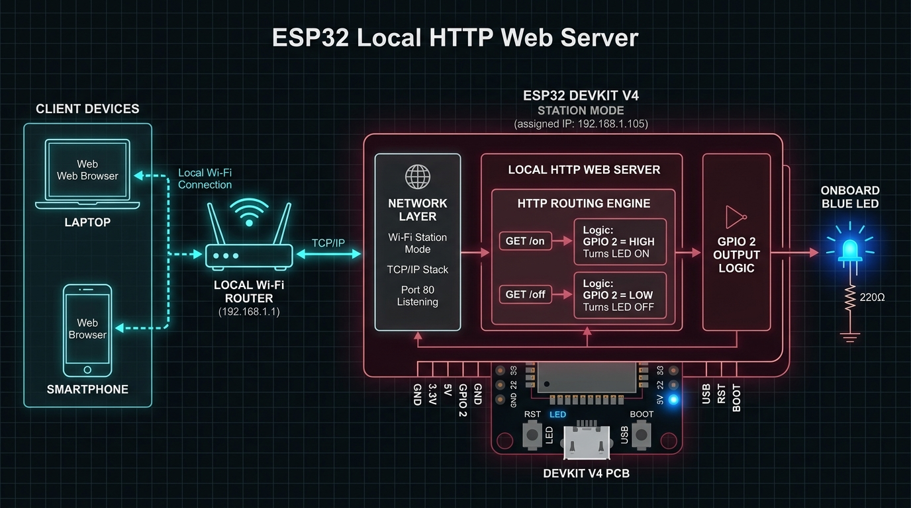
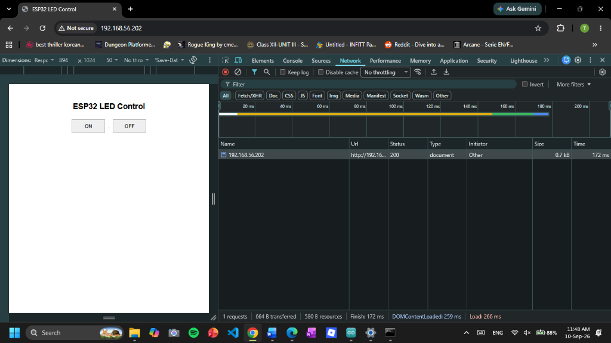
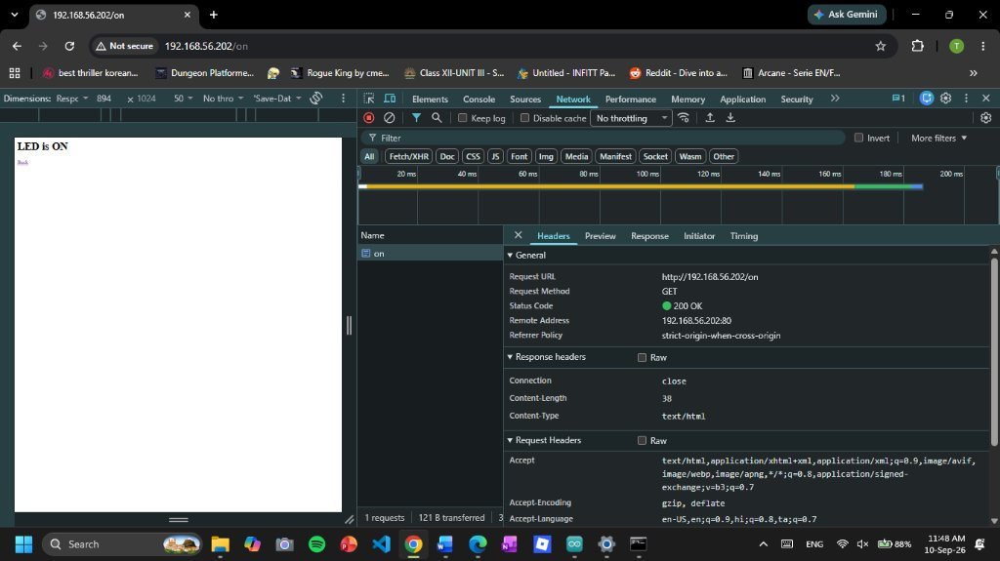
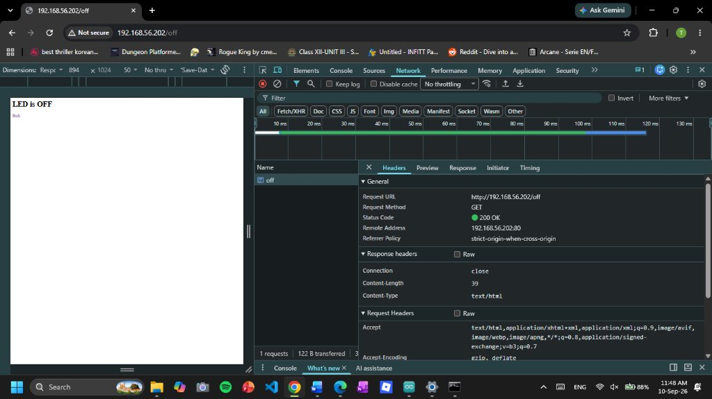
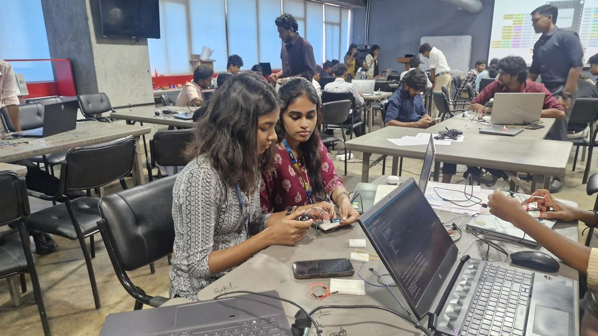
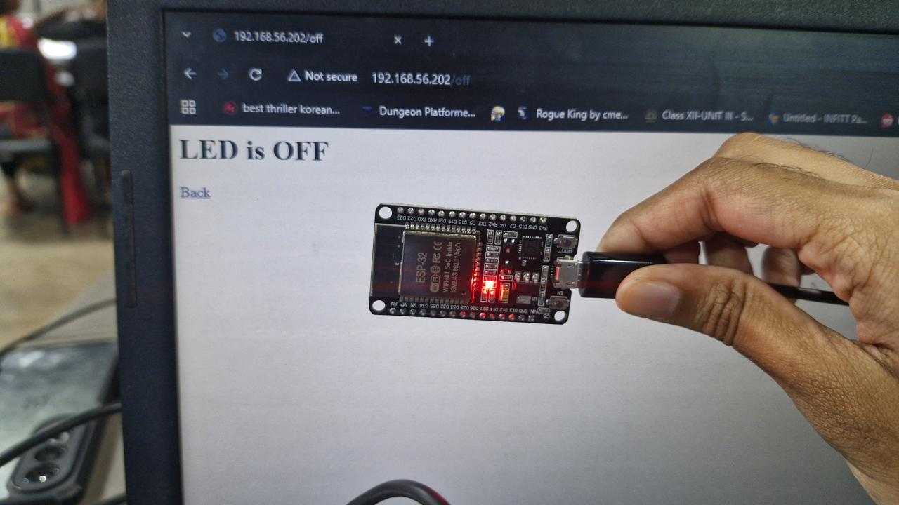
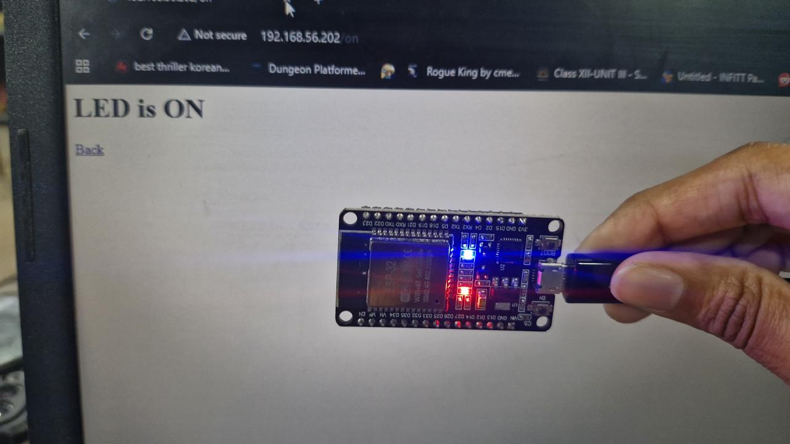

# ESP32 Web Server & HTML LED Control

A standalone Internet of Things (IoT) edge project demonstrating a local HTTP web server hosted directly on an **ESP32-WROOM-32** microcontroller. The server serves an interactive web interface over Wi-Fi, allowing clients on the local network to control an onboard and external LED in real time without external cloud brokers.



---

## 1. Project Overview & Objective

The primary objective of this project is to implement a local, low-latency client-server architecture on an embedded edge device. The ESP32 connects to an existing 802.11 b/g/n Wi-Fi network in Station (STA) mode, acquires a local IPv4 address via DHCP, initializes an HTTP server listening on TCP port `80`, and responds to browser requests by dynamically actuating General Purpose Input/Output (GPIO) pins.

### Key Highlights
- **Direct Edge Hosting:** The ESP32 stores and serves HTML, CSS, and HTTP response headers directly from its internal flash memory.
- **RESTful Endpoint Routing:** Direct mapping of HTTP `GET` requests (`/`, `/on`, `/off`) to physical microcontroller logic.
- **Dual Visual Indication:** Actuates both the ESP32 built-in LED (`GPIO 2`) and an external breadboard circuit (`GPIO 4`).
- **Low Latency & High Reliability:** Sub-200ms round-trip request latency verified via browser Developer Tools.

---

## 2. System Architecture & Communication Flow

```
+-------------------------------------------------------------+
|                  Local Wi-Fi Network (LAN)                  |
|                                                             |
|   +-------------------+              +------------------+   |
|   |  Browser Client   |              |  ESP32 WebServer |   |
|   | (Chrome / Mobile) |              |  (Port 80 / STA) |   |
|   +---------+---------+              +--------+---------+   |
|             |                                 |             |
|             | 1. HTTP GET /                   |             |
|             +-------------------------------->+             |
|             |    HTTP 200 OK (HTML UI)        |             |
|             +<--------------------------------+             |
|             |                                 |             |
|             | 2. User Clicks [ON]             |             |
|             |    HTTP GET /on                 |             |
|             +-------------------------------->+             |
|             |                                 | GPIO 2 HIGH |
|             |                                 | GPIO 4 HIGH |
|             |    HTTP 200 OK ("LED is ON")    |             |
|             +<--------------------------------+             |
|             |                                 |             |
|             | 3. User Clicks [OFF]            |             |
|             |    HTTP GET /off                |             |
|             +-------------------------------->+             |
|             |                                 | GPIO 2 LOW  |
|             |                                 | GPIO 4 LOW  |
|             |    HTTP 200 OK ("LED is OFF")   |             |
|             +<--------------------------------+             |
+-------------------------------------------------------------+
```

1. **Station Mode Initialization:** On boot, the ESP32 connects to the local wireless access point.
2. **Server Listening:** The `WebServer` instance binds to port `80`.
3. **Endpoint Resolution:** When a client issues a `GET` request, the internal dispatch table invokes the bound callback:
   - `GET /` &rarr; Returns the primary user interface with interactive control buttons.
   - `GET /on` &rarr; Sets GPIO 2 & GPIO 4 `HIGH`, returning confirmation text.
   - `GET /off` &rarr; Sets GPIO 2 & GPIO 4 `LOW`, returning confirmation text.

---

## 3. Hardware Requirements & Pinout

### Component Bill of Materials
| Component | Specification / Description | Quantity |
|---|---|:---:|
| **Microcontroller** | ESP32-WROOM-32D Development Board (38-pin / 30-pin) | 1 |
| **LED 1** | Onboard SMD Blue LED (internally tied to `GPIO 2`) | 1 |
| **LED 2** | 5mm Diffused Red/Green LED (External breadboard) | 1 |
| **Current-Limiting Resistor** | 220 $\Omega$ to 330 $\Omega$ 1/4W Carbon Film Resistor | 1 |
| **Breadboard** | 400-point / 830-point Solderless Prototyping Breadboard | 1 |
| **Jumper Wires** | Male-to-Male Dupont Wires | 3 |
| **Power Supply** | Micro-USB Cable (5V / 500mA from PC or adapter) | 1 |

### Wiring & Schematic Table
| ESP32 Pin | Component Connection | Purpose / Logic |
|---|---|---|
| **GPIO 2** | Onboard LED (Internal) | Status indicator (`HIGH` = ON, `LOW` = OFF) |
| **GPIO 4** | External LED Anode (Long Lead) | Actuator drive line |
| **GND** | 220 $\Omega$ Resistor &rarr; LED Cathode (Short Lead) | Common electrical ground reference |

---

## 4. Repository Structure

```
iot-experiment-1-esp32-web-server/
│
├── assets/                               # Architectural diagrams, photographs & screenshots
│   ├── task1-architecture.jpg            # System and network architecture overview
│   ├── task1-web-interface.png           # Chrome browser DevTools inspection (HTTP 200)
│   ├── task1-led-on.jpg                  # Network response for /on endpoint
│   ├── task1-led-off.jpg                 # Network response for /off endpoint
│   ├── task1-img1.jpeg                   # Physical breadboard hardware setup
│   ├── task1-img2.jpeg                   # Hardware bench with external LED lit
│   ├── task1-img3.jpeg                   # Laboratory environment and serial monitor setup
│   └── task1-demo.mp4                    # Complete end-to-end video demonstration
│
├── firmware/                             # Arduino / ESP32 source code
│   └── ESP32_LED_WebServer.ino           # Complete embedded C++ firmware
│
├── .gitignore                            # Standard build artifact exclusions
└── README.md                             # Comprehensive project documentation
```

---

## 5. Software Setup & Firmware Installation

### Prerequisites
1. **Arduino IDE:** Install [Arduino IDE 2.x](https://www.arduino.cc/en/software).
2. **ESP32 Board Package:**
   - Open **File &rarr; Preferences**.
   - Add the following URL into **Additional Board Manager URLs**:
     ```
     https://raw.githubusercontent.com/espressif/arduino-esp32/gh-pages/package_esp32_index.json
     ```
   - Open **Tools &rarr; Board &rarr; Boards Manager**, search for `esp32` by **Espressif Systems**, and install version `2.0.11` or higher.
3. **Libraries:** `WiFi.h` and `WebServer.h` are bundled natively within the official ESP32 core package; no external zip installs are required.

### Firmware Configuration
1. Open [`firmware/ESP32_LED_WebServer.ino`](firmware/ESP32_LED_WebServer.ino) in Arduino IDE.
2. Locate the credential definitions at lines 4–5 and enter your local 2.4 GHz Wi-Fi details:
   ```cpp
   const char* ssid = "YOUR_WIFI_NAME";
   const char* password = "YOUR_WIFI_PASSWORD";
   ```
   > **Note:** The ESP32 does not support 5 GHz Wi-Fi networks. Ensure your router broadcasts on 2.4 GHz.
3. Select your board under **Tools &rarr; Board &rarr; ESP32 Arduino &rarr; ESP32 Dev Module**.
4. Select your serial port under **Tools &rarr; Port** (e.g., `COM3` on Windows).
5. Click **Upload**. Open the **Serial Monitor** at **115200 baud**.

---

## 6. Demonstration Evidence & Screenshots

### Web Control Interface
When navigating to the assigned local IP (e.g., `http://192.168.56.202`), the ESP32 serves the following HTML document:



### Endpoint Actuation & Network Inspection
Inspecting requests via Chrome Developer Tools confirms fast execution, standard HTTP headers, and 200 OK responses:

| Action: Turn LED ON (`GET /on`) | Action: Turn LED OFF (`GET /off`) |
|:---:|:---:|
|  |  |

### Physical Setup
Photographs of the physical prototype wired on a breadboard and powered via USB:

| Hardware Overview | External LED Circuit | Test Bench & IDE Setup |
|:---:|:---:|:---:|
|  |  |  |

### Demonstration Video
A video demonstration of the LED switching in response to browser button presses is available at [`assets/task1-demo.mp4`](assets/task1-demo.mp4).

---

## 7. Troubleshooting & Common Issues

1. **ESP32 Fails to Connect to Wi-Fi (`.` loop indefinitely):**
   - Verify that your Wi-Fi SSID and password are correct.
   - Confirm your router is broadcasting on 2.4 GHz.
   - Place the ESP32 closer to the router to avoid weak signal issues.
2. **Webpage Fails to Load in Browser:**
   - Ensure your smartphone or computer is connected to the exact same Wi-Fi network/subnet as the ESP32.
   - Verify that router client isolation (AP Isolation) is disabled.
3. **LED Does Not Light Up:**
   - Check LED polarity: the longer leg (Anode) must connect to `GPIO 4`, and the shorter leg (Cathode) must connect to `GND` via the 220 $\Omega$ resistor.
   - Confirm pin definition `const int ledPin = 4;` in `ESP32_LED_WebServer.ino`.

---

## 8. Limitations & Future Improvements

- **Current Limitation:** Plain HTTP transmission with no encryption (TLS/HTTPS).
- **Current Limitation:** Browser page navigation triggers full document reload rather than asynchronous background requests (`fetch` / AJAX / WebSockets).
- **Future Roadmap:** Implement mDNS (`esp32.local`) for friendly hostname resolution without checking IP addresses.
- **Future Roadmap:** Upgrade to an asynchronous server (`ESPAsyncWebServer`) with WebSockets for instantaneous, zero-reload bidirectional updates.

---

## Author
**Mithra Ravi**  
Portfolio: [portfolio.v2](https://github.com/mithra4325/portfolio.v2)
